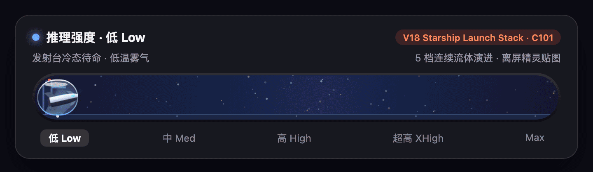
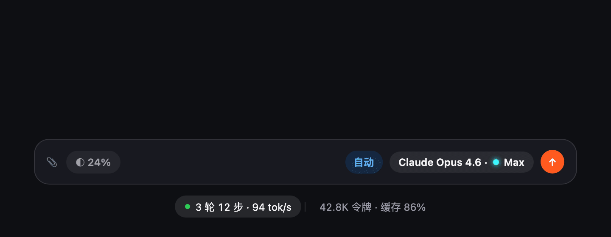
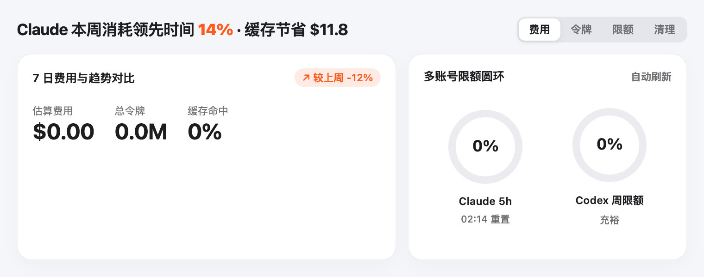
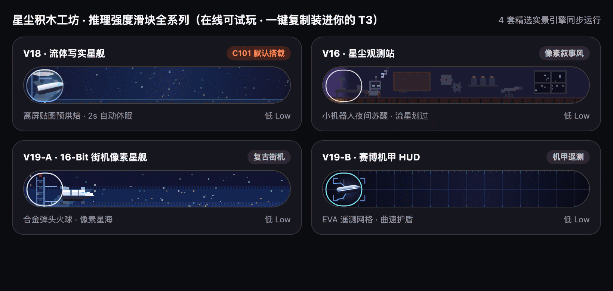

<h1 align="center">Stardust · 星尘</h1>

<p align="center">
  <strong>An unofficial, Apple-crafted AI desktop workbench for macOS</strong><br />
  V18 Starship Effort Slider · Multi-Account Usage & Quota Insights · In-App Update Alerts · Bilingual UX
</p>

<p align="center">
  <a href="https://www.xiaoxin666.cn/stardust"><strong>Website & Interactive Workshop</strong></a> ·
  <a href="#download">Download v1.2.3</a> ·
  <a href="#highlights">Highlights</a> ·
  <a href="#workshop">Stardust Kit</a> ·
  <a href="#updates-privacy">Updates & Privacy</a> ·
  <a href="README.md"><strong>中文</strong></a>
</p>

<p align="center">
  
  
  
  
  
</p>

> [!IMPORTANT]
> **Unofficial project.** Stardust is a personal fork of the open-source [pingdotgg/t3code](https://github.com/pingdotgg/t3code) (MIT). It is **not affiliated with or endorsed by** T3 Code or its team. Any issue you see in Stardust is ours — please report it in [this repo's Issues](https://github.com/zds-xiaoxin/stardust/issues), not upstream.

---

<a id="highlights"></a>

## Highlights & Live Motion Previews

**v1.2** builds on the upstream open-source code as of 2026-11-21 (`0.1.11`, commit `f9b19a7f85`), elevating motion craft, cost/quota visibility, rendering smoothness, and in-app update alerts.

### 1. V18 "Starship Launch Stack" Effort Slider (Pre-baked Sprite Atlas + 2s Auto-Sleep)

Switch reasoning effort across 5 high-contrast stages of a continuous Starship launch — **Pad standby → Raptor ignition → Max-Q breaking clouds → Earth-limb vacuum plume → Deep-space warp** — complete with 180ms tactile upshift feedback (2-frame hitstop, exposure flash, capsule micro-shake, knob recoil, dispersion & shockwave ring) and a Liquid Glass magnifying capsule.

- **Smoothness work**: Volumetric plumes, Mach diamonds, star streaks, clouds, and batched particles are pre-baked into an offscreen sprite atlas (per-frame gradient objects cut from ~120–180 to 6 or fewer). After **2 seconds of idle** the canvas stops redrawing, and resumes instantly on hover, focus, click, or drag.

<p align="center">
  
</p>

### 2. Composer V9 & 3-Layer Session / Token Spring Popovers

- **Unified Model Capsule (Right Composer Cluster)**: Displays provider logo, active model name, and effort accent dot/tier; opens an upward popover stacking Spotlight search, horizontal provider pills, model list with remaining quota, the V18 Starship slider, and a 3-segment sliding permissions footer (default `Full access` stays out of the footer; `Auto` / `Supervised` shows an adjacent chip to the left of the model button).
- **Centered Session Stats Dock**: Magnetic hover pill smoothly tracks between **Session Overview** (rounds, steps, tok/s, model vs tool time split) and **Tokens & Cache** (total tokens, cache read & hit rate) with compositor-only spring popovers.

<p align="center">
  
</p>

### 3. Usage, Cost, Multi-Account Quotas & macOS Cleanup Center

- **4-Tab Analytics Workbench** (Cost / Tokens / Limits / Cleanup): One-shot data animations (rolling numbers, animated trend curves, multi-account quota rings, burndown forecasts, and prior-period comparison) with fast first-open rendering.
- **Persistent Topbar Quota Capsule**: Monitor remaining Claude & Codex windows at a glance without leaving your conversation.
- **Preview-First Disk Cleanup (macOS)**: Inspect per-volume usage, protected directories, and exact removal paths before confirming anything.

<p align="center">
  
</p>

### 4. Human-Readable Task Step Cards, Preview Pin Annotations & Artifact Wall

- **Task Step Cards**: Turns verbose shell commands into clean step timelines with durations and artifact counts (expand to view raw commands).
- **Pin Annotations in Built-in Preview**: Click any DOM element to drop a pin, filter by pending/resolved, jump bidirectionally, and attach cropped screenshots automatically.
- **Artifact Wall**: Browse all generated docs, images, and deliverables per thread or project.

---

<a id="workshop"></a>

## Stardust Kit · Try & Remix Every Slider Engine

Beyond the default **V18 Fluid Starship**, we open-sourced all alternative reasoning slider concepts explored during development — **V16 Stardust Observatory**, **V19-A 16-Bit Pixel Starship**, **V19-B Cyber Mecha HUD**, and **V17 High-Contrast Experiments** (Fusion Reactor / Solar Eclipse / Starsteel Forge).

Try every engine live in the **[Stardust Interactive Workshop](https://www.xiaoxin666.cn/stardust#workshop)**, or open **[`stardust-kit/`](stardust-kit/README.md#english)**: every engine ships a `demo.html` you can open in any browser, plus standalone source code and an AI integration prompt for your own workbench.

<p align="center">
  
</p>

| Kit Module | Visual Style | Directory | Live Demo |
| --- | --- | --- | --- |
| **V18 Fluid Starship** | Default in v1.2 · 5-stage launch + sprite atlas + 2s auto-sleep | [`stardust-kit/v18-starship-fluid`](stardust-kit/v18-starship-fluid/) | [demo.html](stardust-kit/v18-starship-fluid/demo.html) |
| **V16 Stardust Observatory** | Cozy pixel narrative · Midnight robot waking observatory props | [`stardust-kit/v16-stardust-observatory`](stardust-kit/v16-stardust-observatory/) | [demo.html](stardust-kit/v16-stardust-observatory/demo.html) |
| **V19-A 16-Bit Pixel Starship** | Retro hi-bit arcade pixel rocket & fireball plumes | [`stardust-kit/v19-pixel-starship`](stardust-kit/v19-pixel-starship/) | [demo.html](stardust-kit/v19-pixel-starship/demo.html) |
| **V19-B Cyber Mecha HUD** | Telemetry grid, luminous ribbon contrails & warp shield | [`stardust-kit/v19-cyber-hud`](stardust-kit/v19-cyber-hud/) | [demo.html](stardust-kit/v19-cyber-hud/demo.html) |
| **V17 Experiments (4 Themes)** | Starship / Fusion Reactor / Solar Eclipse / Starsteel Forge | [`stardust-kit/v17-thrill-experiments`](stardust-kit/v17-thrill-experiments/) | [demo.html](stardust-kit/v17-thrill-experiments/demo.html) |

---

<a id="updates-privacy"></a>

## Update Alerts & Privacy

### In-App New Version Alerts
- On launch and every 6 hours, the app queries GitHub's public API for this repo's latest stable release (only releases with a complete macOS Apple Silicon build and SHA256 digest count).
- When a newer version exists, you get a notice that links to the release page. **The app never downloads, replaces, or restarts itself** — upgrade manually using the steps under Download & Install.
- Under **Settings → About** you can:
  - switch **Community update mode** between "Standard · Confirm updates manually" (default, links to the release download) and "Source mode · Notify only" (links to the source diff, for people running their own code changes);
  - turn off **Check for community updates automatically**.
- Update checks never send conversations, accounts, or project data.

### Usage Counting & Privacy
- **Stardust active-user count (v1.2.1+, on by default)**: so the author knows how many people use it, the app sends at most once a day a random install ID, the Stardust version, and the OS and CPU type to `xiaoxin666.cn/api/stardust`. No conversations, accounts, projects or file paths. The site endpoint never reads or forwards your IP; the server stores only a re-hash of the install ID, deduplicated per day and deleted after 90 days.
- The first launch of the new version shows a notice with a **Turn off** button; you can switch it any time under **Settings → About → "Count me as an active Stardust user"**. Off means nothing is sent.
- [xiaoxin666.cn/stardust](https://www.xiaoxin666.cn/stardust) publishes a single number: devices active in the last 7 days.
- Upstream's built-in anonymous usage analytics are **off by default** in Stardust; while off, nothing is recorded, buffered, or sent.
- To help upstream, you can opt in under **Settings → About → "Share anonymous usage data"**: it sends feature use, app version, and OS (no prompts, files, or paths) to the upstream project's `ingest.t3.codes`. Turning it off stops sending at once and discards unsent events.

---

<a id="download"></a>

## Download & Install (macOS Apple Silicon)

> **Requirements**: macOS 13+ · Apple Silicon (M1 / M2 / M3 / M4)

- **Direct Download**: [T3-Stardust-v1.2.3-macOS-arm64.zip](https://github.com/zds-xiaoxin/stardust/releases/download/v1.2.3/T3-Stardust-v1.2.3-macOS-arm64.zip) · [Releases & SHA256SUMS.txt](https://github.com/zds-xiaoxin/stardust/releases/tag/v1.2.3) · [Release Notes](docs/community/v1.2.3/RELEASE.en.md)

1. Download the ZIP and `SHA256SUMS.txt` into the same folder and verify:
   ```bash
   shasum -a 256 -c SHA256SUMS.txt
   ```
2. Unzip and drag `Stardust.app` (named `T3 Stardust.app` in v1.2.3 and earlier) into `/Applications`.
   > **Note**: Stardust shares local data (threads, settings, keychain) with official T3 Code, so switching keeps your history — but the two **cannot run at the same time**. Fully quit one before opening the other.
3. Public builds use **ad-hoc signing** (unnotarized). On first launch, allow via **System Settings → Privacy & Security → Open Anyway**, or run:
   ```bash
   xattr -dr com.apple.quarantine "/Applications/T3 Stardust.app"
   ```
4. Works with your own signed-in agent CLIs (Claude Code, Codex, Cursor, OpenCode, or any ACP agent).

---

## License & Upstream Attribution

Unofficial fork of [pingdotgg/t3code](https://github.com/pingdotgg/t3code) under the original [MIT License](LICENSE). "T3" and "T3 Code" are names of the original authors; Stardust is not affiliated with or endorsed by them. Public builds undergo automated privacy scanning and exclude maintainer certificates and personal data.
