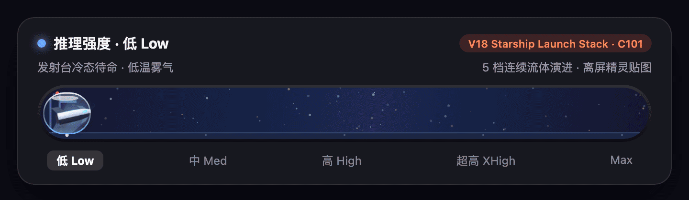
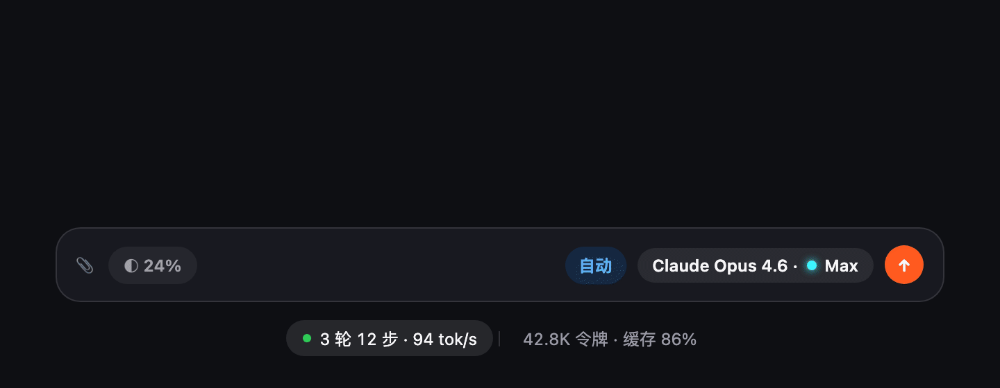
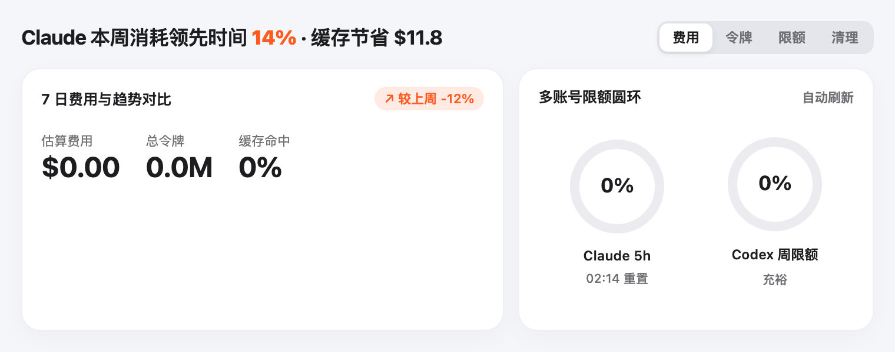
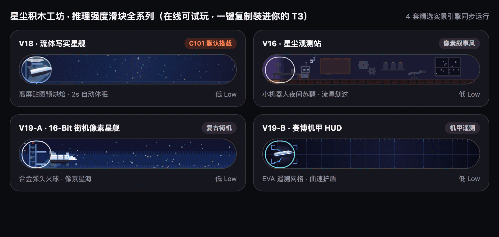

<h1 align="center">星尘 · Stardust</h1>

<p align="center">
  <strong>一个非官方的中文 AI 桌面工作台</strong><br />
  V18 星舰发射栈流体推理滑块 · 多账号用量与限额洞察 · 新版本应用内提醒 · 苹果风极简质感
</p>

<p align="center">
  <a href="https://www.xiaoxin666.cn/stardust"><strong>产品官网与积木工坊</strong></a> ·
  <a href="#download">下载 v1.2.3</a> ·
  <a href="#highlights">核心亮点</a> ·
  <a href="#workshop">星尘积木工坊</a> ·
  <a href="#updates-privacy">更新与隐私</a> ·
  <a href="README.en.md"><strong>English</strong></a>
</p>

<p align="center">
  
  
  
  
  
</p>

> [!IMPORTANT]
> **非官方项目。** 星尘是开源项目 [pingdotgg/t3code](https://github.com/pingdotgg/t3code)（MIT 许可）的个人分支，与 T3 Code 及其团队**没有任何关联，也未获其认可**。星尘里遇到的任何问题都由本仓库负责，请在 [Issues](https://github.com/zds-xiaoxin/stardust/issues) 反馈，不要提交给上游。

---

<a id="highlights"></a>

## 核心亮点与动效实录

**v1.2** 基于上游开源代码截至 2026-11-21 的版本（`0.1.11`，提交 `f9b19a7f85`）二次开发，重点打磨推理交互、用量可视化、界面流畅度与新版本提醒。

### 1. V18「星舰发射栈」流体推理强度滑块（离屏贴图 + 静止 2 秒停止重绘）

每次切换模型推理强度，不再是枯燥的下拉菜单——一艘不锈钢星舰随档位连续演进 5 个高对比视觉阶段：**发射台冷态待命 → 猛禽点火 → Max-Q 音爆破云 → 地球弧线钟形真空羽流 → 深空曲速巡航**，升档自带 180ms 过载打击反馈（2 帧定格、曝光闪、胶囊微震、旋钮反冲、色散与音爆环）与 Liquid Glass 折射放大镜。

- **流畅度优化**：将羽流、激波菱形、星轨、云层与粒子全部预烘焙为离屏精灵贴图（每帧新建的渐变对象从约 120–180 个降到 6 个以内），切档结束静置 **2 秒后自动停止重绘**，鼠标移入、聚焦或拖拽时立即恢复。

<p align="center">
  
</p>

### 2. Composer V9 统一输入台与底部「会话概览 / 令牌缓存」弹簧浮层

- **统一模型触发胶囊（输入台右侧）**：显示当前提供方图标、模型名称与推理档位色点；点击向上展开弹窗，依次集成 Spotlight 模型搜索、横向提供方药丸标签、模型列表（含剩余额度）、V18 星舰推理滑块与底部三段式弹性权限滑块（默认「完全访问」不占底栏，切换为「自动 / 需审批」时在模型胶囊左侧显示独立权限芯片）。
- **居中会话统计浮层**：底部悬停磁吸 Dock 药丸顺滑跟手，点击纯合成层弹簧弹出「会话概览」（轮次/步数/速率/思考与工具耗时占比）与「令牌与缓存」（总计/缓存命中读取与命中率）。

<p align="center">
  
</p>

### 3. 用量、费用、多账号限额与 macOS 清理中心

- **四分页数据工作台**（费用 / 令牌 / 限额 / 清理与整理）：采用一次性数据动效（数字滚动、曲线绘制、双限额圆环、燃尽预测与前一时段对比），首次打开极速渲染。
- **顶栏常驻额度胶囊**：不用切页面就能随时看清 Claude / Codex 剩余额度与重置倒计时。
- **先预览再执行的磁盘清理（macOS）**：按卷查看占用与受保护项，每一条清理建议都先预览路径和去向，确认后才执行。

<p align="center">
  
</p>

### 4. 任务步骤卡、内置预览图钉批注与产物墙

- **任务步骤卡与命令人话描述**：把晦涩终端命令自动折叠成可读步骤卡（如 `跑测试`、`类型检查`），展示耗时与产出数，展开保留原始命令。
- **预览图钉批注**：在内置浏览器预览里直接点元素钉图钉、按「待改 / 已改」筛选、双向定位，发送给助手时自动附带局部截图。
- **产物面板**：集中管理当前会话与项目产出的文档、图片和代码文件。

---

<a id="workshop"></a>

## 星尘积木工坊 · 把喜欢的动画装进你自己的工作台

在打磨 V18 流体星舰的过程中，我们还做出了多套风格迥异的高完成度推理滑块方案（**V16 星尘观测站**、**V19-A 16-Bit 街机像素星舰**、**V19-B 赛博机甲 HUD**、**V17 聚变核心 / 日食弹弓 / 星钢淬火**）。

不想拘泥于默认样式？可以在 **[开源小新 · 星尘积木工坊](https://www.xiaoxin666.cn/stardust#workshop)** 在线拖动全部方案试玩，或者打开本仓库的 **[`stardust-kit/`](stardust-kit/README.md)** 目录：每套方案都带一个可直接在浏览器打开的 `demo.html`，以及独立源码和 AI 改造 Prompt，可以装进你自己的工作台。

<p align="center">
  
</p>

| 积木方案 | 视觉风格 | 仓库目录 | 在线体验 |
| --- | --- | --- | --- |
| **V18 流体写实星舰** | 正式版默认搭载 · 连续飞行 + 离屏贴图 + 2s 自动休眠 | [`stardust-kit/v18-starship-fluid`](stardust-kit/v18-starship-fluid/) | [demo.html](stardust-kit/v18-starship-fluid/demo.html) |
| **V16 星尘观测站** | 治愈像素叙事 · 小机器人夜间逐件点亮观测站与流星 | [`stardust-kit/v16-stardust-observatory`](stardust-kit/v16-stardust-observatory/) | [demo.html](stardust-kit/v16-stardust-observatory/demo.html) |
| **V19-A 16-Bit 像素星舰** | 复古街机高精像素火箭与圆润火焰烟球 | [`stardust-kit/v19-pixel-starship`](stardust-kit/v19-pixel-starship/) | [demo.html](stardust-kit/v19-pixel-starship/demo.html) |
| **V19-B 赛博机甲 HUD** | 高达 / EVA 遥测网格、流体光带尾迹与曲速护盾 | [`stardust-kit/v19-cyber-hud`](stardust-kit/v19-cyber-hud/) | [demo.html](stardust-kit/v19-cyber-hud/demo.html) |
| **V17 高对比实验 4 套** | 星舰 / 聚变核心超频 / 日食引力弹弓 / 星钢淬火 | [`stardust-kit/v17-thrill-experiments`](stardust-kit/v17-thrill-experiments/) | [demo.html](stardust-kit/v17-thrill-experiments/demo.html) |

---

<a id="updates-privacy"></a>

## 更新提醒与隐私说明

### 应用内新版本提醒
- 启动时及之后每 6 小时，应用会请求 GitHub 公开接口，查看本仓库最新的正式发行版（只认带完整 macOS Apple Silicon 安装包和 SHA256 摘要的版本）。
- 发现新版本时弹出提醒，点击直达发行页下载。**应用不会自动下载、替换或重启**，升级请按下方「下载与安装」步骤手动完成。
- 在 **设置 → 关于** 中可以：
  - 切换 **社区更新模式**：「标准版 · 手动确认更新」（默认，跳转发行下载页）或「自行改造 · 仅提醒」（跳转源码差异页，适合自己魔改过代码的用户）；
  - 关闭 **自动检查社区更新**。
- 检查更新不发送聊天、账号或项目数据。

### 使用统计与隐私
- **星尘活跃人数（v1.2.1 起，默认开启）**：为了知道有多少人在用，应用每天最多发送一次：随机安装 ID、星尘版本号、系统和芯片类型，发到 `xiaoxin666.cn/api/stardust`。不发送聊天、账号、项目或文件路径；网站接口不读取也不转发你的 IP，服务器只保存安装 ID 的再哈希值，按天去重，90 天后删除。
- 第一次启动新版本会弹出说明，可以直接点「关闭统计」；之后在 **设置 → 关于 →「计入星尘活跃用户」** 随时开关。关闭后不再发送。
- 网站 [xiaoxin666.cn/stardust](https://www.xiaoxin666.cn/stardust) 只公开「近 7 天活跃设备数」一个数字。
- 上游自带的匿名使用统计在星尘里**默认关闭**，未开启时不记录、不缓存、不发送任何数据。
- 如愿意帮助上游改进，可在 **设置 → 关于 →「共享匿名使用数据」** 手动开启：只发送功能使用、应用版本和操作系统信息（不含提示词、文件或路径）到上游项目的 `ingest.t3.codes`；关闭后立即停止发送并丢弃未发送的事件。

---

<a id="download"></a>

## 下载与安装（macOS Apple Silicon）

> **系统要求**：macOS 13 及以上 · Apple Silicon（M1 / M2 / M3 / M4）

- **安装包下载**：[T3-Stardust-v1.2.3-macOS-arm64.zip](https://github.com/zds-xiaoxin/stardust/releases/download/v1.2.3/T3-Stardust-v1.2.3-macOS-arm64.zip) · [Releases 发行页 & SHA256SUMS.txt](https://github.com/zds-xiaoxin/stardust/releases/tag/v1.2.3) · [详细发行说明](docs/community/v1.2.3/RELEASE.zh.md)

### 快速校验与安装
1. 下载 ZIP 与 `SHA256SUMS.txt` 到同一目录，终端校验完整性：
   ```bash
   shasum -a 256 -c SHA256SUMS.txt
   ```
2. 解压后将 `Stardust.app`（v1.2.3 及更早版本名为 `T3 Stardust.app`）拖入 `/Applications`（升级旧版前建议先等待运行中的任务结束）。
   > **注意**：星尘与上游 T3 Code 共用同一份本机数据（对话、设置、钥匙串），从官方版切换过来历史不会丢；但两者**不能同时运行**，打开其中一个前请先完全退出另一个。
3. 公开版为社区 **ad-hoc 签名**（未经 Apple 付费公证），首次打开若出现系统提示，在 **系统设置 → 隐私与安全性** 点击「仍要打开」，或运行：
   ```bash
   xattr -dr com.apple.quarantine "/Applications/T3 Stardust.app"
   ```
4. 使用你本机已登录的智能体 CLI（Claude Code、Codex、Cursor、OpenCode 或任意 ACP 智能体）。

---

## 开源协议与致谢

本项目是开源项目 [pingdotgg/t3code](https://github.com/pingdotgg/t3code) 的非官方分支，完整保留上游 [MIT 许可证](LICENSE)。“T3”与“T3 Code”是其原作者的名称，星尘与其没有任何关联、也未获其认可。公开构建均经过隐私扫描并去除维护者私有签名与个人路径，随发行页附带构建校验与隐私扫描回执。
